# Azure Onboarding Script for Illumio CloudSecure

## Overview

This PowerShell script automates the process of onboarding Illumio CloudSecure to Azure. It handles the creation or use of Azure AD applications, role assignments, and necessary permissions for Illumio CloudSecure to interact with Azure resources.

## Recent Changes

- Added support for using an existing Azure AD application instead of creating a new one.
- Implemented flexible Network Security Group (NSG) role assignment.
- Added options to specify custom NSG roles by ID or name.

## Scripts

| Script | Purpose |
|---|---|
| `illumio-init.ps1` | Main onboarding script. Requires PowerShell 7.4+ and offers to install the `Az` module if missing. Creates **custom** Illumio roles for NSG/firewall management and supports secret rotation and storage-account firewall whitelisting. |
| `illumio-init-extended.ps1` | Variant that assigns an **existing** (built-in or custom) role for NSG management instead of creating one (`-nsgRoleId` / `-nsgRoleName`). Does not support `-rotateSecret`, `-whitelistStorageAccounts` or `-dataplaneMetadataPath`. |

### Recommendation: use the extended script when the App Registration and SPN are created manually

In many organisations the person onboarding Azure is not allowed to create App Registrations in Entra ID, or app and role creation must go through an identity team or a change process. For these cases use **`illumio-init-extended.ps1`** together with `-existingAppId` / `-existingAppSecret`:

- The script **creates nothing in Entra ID**. It looks up the service principal you created and only assigns Azure RBAC roles.
- With `-nsgRoleId` / `-nsgRoleName` you can assign a role that already exists and was approved, either built-in (default: *Network Security Group Contributor*) or a custom role defined by your team. `illumio-init.ps1` would instead create its own custom `Illumio Network Security Administrator-<id>` role.
- If anything fails, an existing app is **never deleted**.

Use `illumio-init.ps1` when the script may create the app itself, or when you need `-rotateSecret` or `-whitelistStorageAccounts`.

#### Manual preparation

1. **Create the App Registration** (Entra ID → App registrations → New registration, single tenant, no redirect URI), or use `az ad app create --display-name Illumio-CloudSecure-Access`.
2. **Create the Service Principal** (Enterprise Application). The Portal creates it automatically; with the CLI, run `az ad sp create --id <appId>`. The script fails with *"Unable to find Service Principal"* if this step is skipped.
3. **Create a client secret** (Certificates & secrets → New client secret, or `az ad app credential reset --id <appId> --years 1`). Copy the secret **value**, not the secret ID.
4. *(Optional, with `-nsg`)* Choose or create the NSG role to assign and note its name or ID.
5. Run the extended script:

```powershell
./illumio-init-extended.ps1 -sid <subscription-id> `
    -existingAppId <appId> -existingAppSecret <secret-value> `
    -nsg -nsgRoleName "Network Security Group Contributor" `
    -storageAccounts "/subscriptions/<sub>/resourceGroups/<rg>/providers/Microsoft.Storage/storageAccounts/<sa>" `
    -serviceAccountKey <key> -serviceAccountToken <token> -csTenantId <cs-tenant-id> -url <url>
```

The user running the script still needs **Owner** or **User Access Administrator** on the scope to create the role assignments. With `-nsg` or `-azfw`, the script also creates the custom `Illumio Firewall Administrator-<id>` role, which requires **Owner** (User Access Administrator cannot create role definitions).

## Flow

The diagram shows every step of both scripts. Steps marked **[init]** exist only in `illumio-init.ps1`, and steps marked **[ext]** only in `illumio-init-extended.ps1`.

```mermaid
flowchart TD
    A([Start]) --> P{"[init] PowerShell ≥ 7.4<br/>and Az module installed?"}
    P -- "No Az module" --> PI["Offer to install Az module"]
    PI -- declined / failed --> X1([Exit 1])
    PI -- installed --> L
    P -- "PS too old" --> X1
    P -- yes --> L{"Az context<br/>present?"}
    L -- no --> LA["Connect-AzAccount<br/>(device code login)"] --> N
    L -- yes --> N["App name = -name<br/>or 'Illumio-CloudSecure-Access'"]
    N --> V{"serviceAccountKey, serviceAccountToken,<br/>csTenantId and url set?"}
    V -- no --> X2([Exit 1])
    V -- yes --> S{"-sid or -tid?"}
    S -- "-sid" --> SS["scope = /subscriptions/&lt;sid&gt;"]
    S -- "-tid" --> ST["scope = /providers/Microsoft.Management/<br/>managementGroups/&lt;tid&gt;"]
    S -- neither --> X2
    SS --> UP{"Signed-in user has Owner or<br/>User Access Administrator on scope?"}
    ST --> UP
    UP -- no --> X2
    UP -- yes --> SEL["Select subscription / tenant context"]

    SEL --> M{"Mode"}
    M -- "-remove" --> R1["Remove 'Storage Blob Data Contributor'<br/>assignments of the app"]
    R1 --> R2["Per subscription in tenant: remove<br/>'Illumio Firewall Administrator-&lt;sub&gt;'<br/>assignments + role definition"]
    R2 --> R3["Delete App Registrations named &lt;app name&gt;"] --> E

    M -- "[init] -whitelistStorageAccounts" --> W1{"-storageAccounts given?"}
    W1 -- no --> E
    W1 -- yes --> W2["Download dataplane IP metadata"]
    W2 --> W3["Per storage account: look up region,<br/>map to dataplane IP group"]
    W3 --> W4["Add missing IPs as Allow rules<br/>to storage account firewall"] --> E

    M -- "[init] -clientId + -rotateSecret" --> RS1["Create new client secret<br/>(-secretExpirationDays)"]
    RS1 --> RS2["POST credentials to CloudSecure"] --> E

    M -- "-clientId" --> C1{"Service Principal for<br/>clientId exists?"}
    C1 -- no --> X3([Error])
    C1 -- yes --> CST{"-storageAccounts?"}
    CST -- yes --> GS
    CST -- no --> CN
    GS["Grant storage access"] --> CN{"-nsg?"}
    CN -- yes --> CNG["Grant NSG role + Firewall role"] --> CF
    CN -- no --> CF{"-azfw?"}
    CF -- yes --> CFG["Grant Firewall role"] --> E
    CF -- no --> E

    M -- "no clientId (onboarding)" --> I1{"Storage accounts given<br/>but none found?"}
    I1 -- yes --> FAIL
    I1 -- no --> I2{"-azfw?"}
    I2 -- yes --> I3["Register AFW features<br/>AFWEnableNetworkRuleNameLogging,<br/>AFWEnableStructuredLogs<br/>+ Microsoft.Network provider"] --> I4
    I2 -- no --> I4{"-existingAppId AND<br/>-existingAppSecret?"}
    I4 -- yes --> I5{"Service Principal<br/>exists?"}
    I5 -- no --> FAIL
    I5 -- yes --> I8
    I4 -- no --> I6["Create App Registration<br/>+ client secret (-secretExpirationDays)"]
    I6 --> I7["Create Service Principal"] --> I8
    I8["Assign 'Reader' on scope"] --> I9{"-storageAccounts?"}
    I9 -- yes --> I10["Grant storage access"] --> I11
    I9 -- no --> I11{"-nsg?"}
    I11 -- yes --> I12["Grant NSG role"] --> I13["Grant Firewall role"] --> I14
    I11 -- no --> I14["POST client_id, secret, tenant,<br/>subscription to CloudSecure<br/>(type AzureRole)"]
    I14 --> E

    FAIL["Rollback: delete newly created app<br/>(never an existing app)<br/>[init] send failure event to CloudSecure"] --> X3

    E([Restore original subscription context])

    subgraph SA["Storage access"]
      GS1["Assign 'Storage Blob Data Reader'<br/>on each storage account"] --> GS2["POST granted accounts to CloudSecure<br/>(type AzureFlow)"]
    end

    subgraph NR["NSG role"]
      NR1{"Script?"}
      NR1 -- "[init]" --> NR2["Create / update custom role<br/>'Illumio Network Security Administrator-&lt;id&gt;'<br/>and assign it"]
      NR1 -- "[ext]" --> NR3["Assign role from -nsgRoleId / -nsgRoleName<br/>(fallback: 'Network Security Group Contributor')"]
    end

    subgraph FR["Firewall role"]
      FR1["Register Microsoft.Network"] --> FR2["Create custom role<br/>'Illumio Firewall Administrator-&lt;id&gt;'<br/>if missing, then assign it"]
    end
```



## Parameters

All parameters are optional at the PowerShell level, but the script validates the required ones at runtime and exits with an error if they are missing.

### Required

| Parameter | Type | Default | Description |
|---|---|---|---|
| `-serviceAccountKey` | string | `""` | Illumio CloudSecure service account key (the "username" part). Combined with `-serviceAccountToken` into the HTTP Basic auth header for CloudSecure API calls. |
| `-serviceAccountToken` | string | `""` | Illumio CloudSecure service account token (the "password" part). |
| `-csTenantId` | string | `""` | Illumio CloudSecure tenant ID. Sent as the `X-Tenant-Id` header on every API call. |
| `-url` | string | `""` | Base URL of your Illumio CloudSecure console (e.g. `https://cloud.illum.io`). Credentials are posted to `<url>/api/v1/integrations/cloud_credentials`. URLs containing `dev.cloud`, `qa.cloud`, `stage.cloud` or `cloud.sunnyvale.` are redirected to Illumio internal proxies (internal testing only). |
| `-sid` **or** `-tid` | string | `""` | Onboarding scope — exactly one is needed (see below). |

### Onboarding scope

| Parameter | Type | Default | Description |
|---|---|---|---|
| `-sid` | string | `""` | Azure **subscription ID** to onboard. Scope becomes `/subscriptions/<sid>`; the tenant is taken from your current Az context. Takes precedence over `-tid` if both are given. |
| `-tid` | string | `""` | Azure **tenant ID** to onboard the whole tenant. Scope becomes `/providers/Microsoft.Management/managementGroups/<tid>` (the tenant root management group, whose ID equals the tenant ID). |

You must hold **Owner** or **User Access Administrator** on the chosen scope; the script checks this before doing anything.

### App registration

| Parameter | Type | Default | Description |
|---|---|---|---|
| `-name` | string | `Illumio-CloudSecure-Access` | Display name of the Azure AD (Entra ID) app registration the script creates. Also used by `-remove` to find the app to delete, so pass the same value for both. |
| `-secretExpirationDays` | single, 1–1000 | `365` | Lifetime in days of the client secret generated for a newly created app (or by `-rotateSecret`). |
| `-existingAppId` | string | `""` | Application (client) ID of an **existing** app registration to use instead of creating a new one. The app must already have a service principal in the tenant. Only takes effect together with `-existingAppSecret`; otherwise a new app is created. The script assigns roles and sends these credentials to CloudSecure. On failure, the existing app is never deleted. |
| `-existingAppSecret` | string | `""` | Client secret value for `-existingAppId`. Sent (base64-encoded) to CloudSecure. |
| `-clientId` | string | `""` | Application (client) ID of an app that was **already onboarded** to CloudSecure. When set, no app is created and no credentials are sent; the script only adds the permissions requested by `-storageAccounts`, `-nsg` and/or `-azfw` to that app. In `illumio-init.ps1`, combine with `-rotateSecret` to rotate its secret instead. |

> **`-existingAppId` vs. `-clientId`:** use `-existingAppId`/`-existingAppSecret` for a first-time onboarding with an app you created yourself. Use `-clientId` to extend the permissions of an app that is already onboarded.

### Permissions / features

| Parameter | Type | Default | Description |
|---|---|---|---|
| `-storageAccounts` | string[] | — | Storage accounts holding flow logs. Pass full resource IDs (`/subscriptions/<sub>/resourceGroups/<rg>/providers/Microsoft.Storage/storageAccounts/<name>`); accounts are matched by name against those visible in the current subscription and the resource ID is used as the role-assignment scope. The app gets **Storage Blob Data Reader** on each one, and the list of granted accounts is sent to CloudSecure. The script fails if none of the given accounts exist. |
| `-nsg` | switch | off | Grant Network Security Group management. In `illumio-init.ps1` this creates/updates and assigns the custom roles `Illumio Network Security Administrator-<sid\|tid>` and `Illumio Firewall Administrator-<sid\|tid>`. In `illumio-init-extended.ps1` it assigns the role selected by `-nsgRoleId`/`-nsgRoleName` (default: built-in *Network Security Group Contributor*) plus the Illumio firewall role. |
| `-azfw` | switch | off | Azure Firewall support. For a new app it registers the `Microsoft.Network` provider and the `AFWEnableNetworkRuleNameLogging` / `AFWEnableStructuredLogs` features. With `-clientId` it also assigns the `Illumio Firewall Administrator-<sid\|tid>` role. Note: for a new app, the firewall role itself is only assigned when `-nsg` is also set. |
| `-nsgRoleId` | string | `""` | *(extended only)* Role definition ID (GUID) of an existing role to assign for NSG management. Takes precedence over `-nsgRoleName`. Falls back to the default role if not found. |
| `-nsgRoleName` | string | `""` | *(extended only)* Name of an existing role to assign for NSG management. Falls back to the default role if not found. |

### Maintenance actions

These change what the script does. They are checked in this order, and the first match runs and exits.

| Parameter | Type | Default | Description |
|---|---|---|---|
| `-remove` | switch | off | Offboard: removes the app's *Storage Blob Data Contributor* assignments, the `Illumio Firewall Administrator-<subscription>` role and its assignments in every subscription of the tenant, and every app registration named `-name` (default `Illumio-CloudSecure-Access`). Note: it does not remove the NSG role or the *Reader* / *Storage Blob Data Reader* assignments. |
| `-whitelistStorageAccounts` | switch | off | *(illumio-init.ps1 only)* Instead of onboarding, adds the Illumio CloudSecure data-plane IPs for each storage account's region to that account's firewall (`IPRules`, action *Allow*). Requires `-storageAccounts` as full resource IDs (the resource group is read from the ID). The IP list is downloaded from Illumio's dataplane metadata URL. Existing rules are kept. |
| `-rotateSecret` | switch | off | *(illumio-init.ps1 only, requires `-clientId`)* Creates a new client secret (valid for `-secretExpirationDays`) on the given app and sends it to CloudSecure. Old secrets are not deleted. |
| `-dataplaneMetadataPath` | string | `""` | *(illumio-init.ps1 only)* Declared but **currently unused**: `-whitelistStorageAccounts` always downloads the metadata from the built-in URL. |

## Usage

Sign in first (`Connect-AzAccount`); otherwise the script starts a device-code login.

### Onboard a subscription (creates a new app)

```powershell
./illumio-init.ps1 -sid <subscription-id> `
    -serviceAccountKey <key> -serviceAccountToken <token> `
    -csTenantId <cs-tenant-id> -url https://cloud.illum.io
```

### Onboard a tenant with flow-log storage and NSG management

```powershell
./illumio-init.ps1 -tid <tenant-id> -nsg `
    -storageAccounts "/subscriptions/<sub>/resourceGroups/<rg>/providers/Microsoft.Storage/storageAccounts/<sa>" `
    -serviceAccountKey <key> -serviceAccountToken <token> -csTenantId <cs-tenant-id> -url <url>
```

### Use an existing app registration

```powershell
./illumio-init.ps1 -sid <subscription-id> `
    -existingAppId <app-client-id> -existingAppSecret <secret> `
    -serviceAccountKey <key> -serviceAccountToken <token> -csTenantId <cs-tenant-id> -url <url>
```

### Add permissions to an already-onboarded app

```powershell
./illumio-init.ps1 -sid <subscription-id> -clientId <app-client-id> -azfw `
    -serviceAccountKey <key> -serviceAccountToken <token> -csTenantId <cs-tenant-id> -url <url>
```

### Rotate the client secret

```powershell
./illumio-init.ps1 -sid <subscription-id> -clientId <app-client-id> -rotateSecret -secretExpirationDays 180 `
    -serviceAccountKey <key> -serviceAccountToken <token> -csTenantId <cs-tenant-id> -url <url>
```

### Assign a custom NSG role (extended script)

```powershell
./illumio-init-extended.ps1 -sid <subscription-id> -nsg -nsgRoleName "My NSG Role" `
    -serviceAccountKey <key> -serviceAccountToken <token> -csTenantId <cs-tenant-id> -url <url>
```

### Offboard

```powershell
./illumio-init.ps1 -sid <subscription-id> -remove `
    -serviceAccountKey <key> -serviceAccountToken <token> -csTenantId <cs-tenant-id> -url <url>
```

## NSG Role Assignment

The script now supports flexible NSG role assignment:

1. If `$nsgRoleId` is provided, it attempts to use the role with that ID.
2. If `$nsgRoleName` is provided, it attempts to use the role with that name.
3. If neither is provided or if the specified role is not found, it falls back to the default "Network Security Group Contributor" role.

This allows for more granular control over the permissions granted to the Illumio CloudSecure application in Azure.

## Notes

- Ensure you have the necessary Azure PowerShell modules installed and are logged into your Azure account before running the script.
- The script requires appropriate permissions in Azure to create/modify applications and assign roles.
- Always review and test the script in a non-production environment before using it in production.