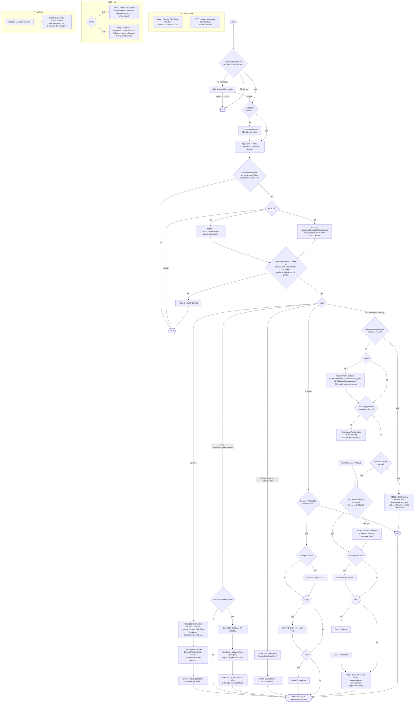

# Azure Onboarding Script for Illumio CloudSecure

## Overview

These PowerShell scripts onboard an Azure subscription or a whole Azure tenant to Illumio CloudSecure. They prepare an Entra ID (Azure AD) application for CloudSecure, either by creating one or by using one you created. They grant it the Azure RBAC roles CloudSecure needs and send its credentials to your CloudSecure tenant.

## Recent Changes

- The permission check now recognises **Owner** / **User Access Administrator** granted through (nested) **group membership**, not only direct assignments.
- Re-runs no longer fail when a role is already assigned (`Conflict`). The extended script checks for an existing **Reader** assignment before assigning it.
- Added support for using an existing Azure AD application instead of creating a new one.
- Implemented flexible Network Security Group (NSG) role assignment, with custom NSG roles by ID or name (extended script).

## Scripts

| Script | Purpose |
|---|---|
| `illumio-init.ps1` | Main onboarding script. Requires PowerShell 7.4+ and offers to install the `Az` module if missing. Creates **custom** Illumio roles for NSG/firewall management and supports secret rotation and storage-account firewall whitelisting. It reports failures to CloudSecure as account events. |
| `illumio-init-extended.ps1` | Variant that assigns an **existing** (built-in or custom) role for NSG management instead of creating one (`-nsgRoleId` / `-nsgRoleName`). Does not support `-rotateSecret`, `-whitelistStorageAccounts` or `-dataplaneMetadataPath`, and does not send failure events. |

### Recommendation: use the extended script when the App Registration and SPN are created manually

In many organisations the person onboarding Azure is not allowed to create App Registrations in Entra ID, or app and role creation must go through an identity team or a change process. For these cases use **`illumio-init-extended.ps1`** together with `-existingAppId` / `-existingAppSecret`:

- The script **creates nothing in Entra ID**. It looks up the service principal you created and only assigns Azure RBAC roles.
- With `-nsgRoleId` / `-nsgRoleName` you can assign a role that already exists and was approved, either built-in (default: *Network Security Group Contributor*) or a custom role defined by your team. `illumio-init.ps1` would instead create its own custom `Illumio Network Security Administrator-<id>` role.
- If the identity team already granted **Reader**, the script detects it and skips that assignment.
- If anything fails, an existing app is **never deleted**.

Use `illumio-init.ps1` when the script may create the app itself, or when you need `-rotateSecret` or `-whitelistStorageAccounts`.

#### Manual preparation

1. **Create the App Registration** (Entra ID → App registrations → New registration, single tenant, no redirect URI), or use `az ad app create --display-name Illumio-CloudSecure-Access`.
2. **Create the Service Principal** (Enterprise Application). The Portal creates it automatically; with the CLI, run `az ad sp create --id <appId>`. The script fails with *"Unable to find Service Principal"* if this step is skipped.
3. **Create a client secret** (Certificates & secrets → New client secret, or `az ad app credential reset --id <appId> --years 1`). Copy the secret **value**, not the secret ID.
4. *(Optional)* Assign **Reader** on the subscription or tenant root management group to the service principal. If you skip this, the script assigns it.
5. *(Optional, with `-nsg`)* Choose or create the NSG role to assign and note its name or ID.
6. Run the extended script:

```powershell
./illumio-init-extended.ps1 -sid <subscription-id> `
    -existingAppId <appId> -existingAppSecret <secret-value> `
    -nsg -nsgRoleName "Network Security Group Contributor" `
    -storageAccounts "/subscriptions/<sub>/resourceGroups/<rg>/providers/Microsoft.Storage/storageAccounts/<sa>" `
    -serviceAccountKey <key> -serviceAccountToken <token> -csTenantId <cs-tenant-id> -url <url>
```

See [Required permissions for the person running the script](#required-permissions-for-the-person-running-the-script) for the Azure roles the operator needs.

## What the script does

This section describes every step in the order the script runs it. Steps marked **[init]** exist only in `illumio-init.ps1`, and steps marked **[ext]** only in `illumio-init-extended.ps1`.

### 1. Environment check [init]

- Requires **PowerShell 7.4 or newer**; otherwise it exits.
- Checks that the **`Az` module** is installed. If not, it asks whether to install it (`Install-Module Az -Scope CurrentUser`); declining exits the script.
- If this step fails, a failure event is sent to CloudSecure (see [Data sent to CloudSecure](#data-sent-to-cloudsecure)).

### 2. Sign-in

If there is no Az context (`Get-AzContext`), the script starts a **device-code login** (`Connect-AzAccount -UseDeviceAuthentication`). The subscription and tenant of the current context are remembered so they can be restored at the end.

### 3. Input validation

- The app display name is `-name`, or `Illumio-CloudSecure-Access` by default.
- `-serviceAccountKey`, `-serviceAccountToken`, `-csTenantId` and `-url` must be set; otherwise the script exits.

### 4. Scope selection

| Input | Scope used for all role assignments | Azure context selected |
|---|---|---|
| `-sid` (wins if both are given) | `/subscriptions/<sid>` | That subscription, in the tenant of the current context |
| `-tid` | `/providers/Microsoft.Management/managementGroups/<tid>` (tenant root management group) | That tenant |
| neither | — | The script exits |

### 5. Permission check of the signed-in user

The script checks that **you** hold **Owner** or **User Access Administrator** on the scope:

- It reads the role assignments of the signed-in user **including all groups the user is a member of, transitively** (`Get-AzRoleAssignment -ObjectId <user> -ExpandPrincipalGroups`). This switch cannot be combined with `-Scope`, so the check runs **after** the target subscription or tenant is selected in step 4.
- Only assignments that cover the whole scope count:
  - **Subscription:** an assignment on the subscription itself, on any of its parent management groups, or on the root (`/`).
  - **Tenant:** an assignment on the tenant root management group or on the root (`/`).
  - An assignment on a single resource group, a single subscription (for `-tid`), or a child management group does **not** count.
- If the check fails, the original Azure context is restored and the script exits. `illumio-init.ps1` also sends a failure event to CloudSecure.

### 6. Mode selection

Exactly one of the following modes runs, chosen in this order:

| Order | Condition | Mode |
|---|---|---|
| 1 | `-remove` | [Offboarding](#offboarding--remove) |
| 2 | `-whitelistStorageAccounts` [init] | [Storage firewall whitelisting](#storage-firewall-whitelisting--whiteliststorageaccounts-init) |
| 3 | no `-clientId` | [Onboarding](#onboarding-default) |
| 4 | `-clientId` and `-rotateSecret` [init] | [Secret rotation](#secret-rotation--clientid---rotatesecret-init) |
| 5 | `-clientId` | [Add permissions to an onboarded app](#add-permissions-to-an-onboarded-app--clientid) |

#### Onboarding (default)

1. **Storage account validation:** if `-storageAccounts` is given, at least one of them must exist in the selected subscription; otherwise the run fails.
2. **Azure Firewall preparation** (`-azfw` only): registers the provider features `AFWEnableNetworkRuleNameLogging` and `AFWEnableStructuredLogs` and the `Microsoft.Network` resource provider.
3. **Application:**
   - **With `-existingAppId` and `-existingAppSecret`:** looks up the service principal of that app. If none exists, the run fails. Nothing is created in Entra ID.
   - **Otherwise:** creates an App Registration named `<app name>`, then a client secret valid for `-secretExpirationDays` days (key identifier `illumio`), and then a service principal described as *Illumio App Service Principal*.
4. **Reader role:** assigns the built-in **Reader** role to the service principal on the scope.
   - **[ext]** first checks whether Reader is already assigned on the scope or inherited from a parent scope, and skips the assignment if so.
   - Both scripts treat an "already assigned" (`Conflict`) response as success.
5. **Storage access** (`-storageAccounts` only): see [Storage access](#storage-access).
6. **NSG and firewall access** (`-nsg` only): grants the [NSG role](#nsg-role) and then the [firewall role](#firewall-role).
7. **Send credentials to CloudSecure:** posts the client ID, client secret, Azure tenant ID and (for `-sid`) the subscription ID (see [Data sent to CloudSecure](#data-sent-to-cloudsecure)).

If any of steps 1–7 fails:

- an App Registration that **this run created** is deleted again (an existing app is never deleted);
- **[init]** a failure event is sent to CloudSecure;
- role assignments and role definitions created before the failure are **not** rolled back.

#### Add permissions to an onboarded app (`-clientId`)

For an app that is already onboarded. No app or secret is created, and no credentials are sent.

1. Looks up the service principal of `-clientId`; fails if it does not exist.
2. `-storageAccounts`: grants [storage access](#storage-access).
3. `-nsg`: grants the [NSG role](#nsg-role) and the [firewall role](#firewall-role).
4. `-azfw`: grants the [firewall role](#firewall-role).

#### Secret rotation (`-clientId` + `-rotateSecret`) [init]

1. Creates a new client secret on the app, valid for `-secretExpirationDays` days. Old secrets are kept.
2. Sends the new credentials to CloudSecure.

#### Storage firewall whitelisting (`-whitelistStorageAccounts`) [init]

Does not onboard anything. Instead it lets CloudSecure's data plane reach your flow-log storage accounts through their firewalls:

1. Exits without changes if `-storageAccounts` is not given.
2. Downloads the data-plane metadata (IP groups per region) from Illumio's built-in URL to a temporary file. If the download fails or the file has no `ipGroups` and `regions` keys, it skips the update.
3. For each storage account (full resource ID required; the resource group is read from the ID):
   - reads the account's region and maps it to a data-plane IP group via `regions`;
   - skips the account if the region is not mapped, or maps to itself;
   - adds every IP of that group that is not already listed as an **Allow** IP rule (`Update-AzStorageAccountNetworkRuleSet`). Existing rules, the bypass and the default action are kept.

#### Offboarding (`-remove`)

1. For every subscription of the current tenant that has a **saved Az context** (`Get-AzContext -ListAvailable`):
   - removes **Storage Blob Data Contributor** assignments whose principal is named `<app name>`;
   - removes the role `Illumio Firewall Administrator-<subscription-id>`, including its assignments.
2. Deletes every App Registration named `<app name>` (`-name`, default `Illumio-CloudSecure-Access`). Deleting the app also deletes its service principal and secrets.

It does **not** remove the NSG role, the Reader assignment, the *Storage Blob Data Reader* assignments, or a firewall role created with `-tid` (named after the tenant ID). It also does not notify CloudSecure.

### 7. Cleanup

In every case the script finally switches back to the subscription and tenant that were selected before it started.

### Shared building blocks

#### Storage access

1. Assigns **Storage Blob Data Reader** to the service principal on each storage account given in `-storageAccounts` that exists in the selected subscription. Duplicates are removed, and an existing assignment counts as granted.
2. Posts the list of storage accounts that were granted to CloudSecure (type `AzureFlow`).

Errors on single storage accounts are logged and do not stop the run.

#### NSG role

- **[init]** Uses the custom role **`Illumio Network Security Administrator-<sid or tid>`**, assignable on the scope only:
  - creates it if missing;
  - if it exists but lacks permissions, adds the missing actions (`Set-AzRoleDefinition`);
  - assigns it to the service principal.
- **[ext]** Assigns an existing role:
  1. the role with ID `-nsgRoleId`, if given and found;
  2. otherwise the role named `-nsgRoleName`, if given and found;
  3. otherwise the built-in **Network Security Group Contributor**.

<details>
<summary>Permissions of <code>Illumio Network Security Administrator-&lt;id&gt;</code> [init]</summary>

```
Microsoft.Network/networkInterfaces/effectiveNetworkSecurityGroups/action
Microsoft.Network/networkSecurityGroups/read
Microsoft.Network/networkSecurityGroups/write
Microsoft.Network/networkSecurityGroups/delete
Microsoft.Network/networkSecurityGroups/join/action
Microsoft.Network/networkSecurityGroups/defaultSecurityRules/read
Microsoft.Network/networkSecurityGroups/securityRules/write
Microsoft.Network/networkSecurityGroups/securityRules/delete
Microsoft.Network/networksecuritygroups/providers/Microsoft.Insights/diagnosticSettings/read
Microsoft.Network/networksecuritygroups/providers/Microsoft.Insights/diagnosticSettings/write
Microsoft.Network/networksecuritygroups/providers/Microsoft.Insights/logDefinitions/read
Microsoft.Network/networkWatchers/securityGroupView/action
Microsoft.Network/networkSecurityGroups/*
Microsoft.Network/networkInterfaces/read
Microsoft.Network/networkInterfaces/write
Microsoft.Network/virtualNetworks/read
Microsoft.Network/virtualNetworks/subnets/write
Microsoft.Network/virtualNetworks/subnets/read
Microsoft.Authorization/locks/*
Microsoft.Compute/virtualMachines/read
Microsoft.Network/virtualNetworks/subnets/join/action
Microsoft.Network/publicIPAddresses/read
Microsoft.Network/publicIPAddresses/join/action
```

</details>

#### Firewall role

Both scripts register the `Microsoft.Network` provider and use the custom role **`Illumio Firewall Administrator-<sid or tid>`**, assignable on the scope only. The role is created if missing and then assigned to the service principal. An existing role is not updated.

<details>
<summary>Permissions of <code>Illumio Firewall Administrator-&lt;id&gt;</code></summary>

```
Microsoft.Network/azurefirewalls/read
Microsoft.Network/azurefirewalls/learnedIPPrefixes/action
Microsoft.Network/azureFirewalls/applicationRuleCollections/write
Microsoft.Network/azureFirewalls/applicationRuleCollections/delete
Microsoft.Network/azureFirewalls/applicationRuleCollections/read
Microsoft.Network/azurefirewalls/providers/Microsoft.Insights/logDefinitions/read
Microsoft.Network/azureFirewalls/natRuleCollections/write
Microsoft.Network/azureFirewalls/natRuleCollections/read
Microsoft.Network/azureFirewalls/natRuleCollections/delete
Microsoft.Network/azureFirewalls/networkRuleCollections/read
Microsoft.Network/azureFirewalls/networkRuleCollections/write
Microsoft.Network/azureFirewalls/networkRuleCollections/delete
Microsoft.Network/azureFirewallFqdnTags/read
Microsoft.Network/azurefirewalls/providers/Microsoft.Insights/metricDefinitions/read
Microsoft.Network/firewallPolicies/read
Microsoft.Network/firewallPolicies/write
Microsoft.Network/firewallPolicies/join/action
Microsoft.Network/firewallPolicies/certificates/action
Microsoft.Network/firewallPolicies/delete
Microsoft.Network/firewallPolicies/ruleCollectionGroups/read
Microsoft.Network/firewallPolicies/ruleCollectionGroups/write
Microsoft.Network/firewallPolicies/ruleCollectionGroups/delete
Microsoft.Network/firewallPolicies/ruleGroups/read
Microsoft.Network/firewallPolicies/ruleGroups/write
Microsoft.Network/firewallPolicies/ruleGroups/delete
Microsoft.Network/ipGroups/read
Microsoft.Network/ipGroups/write
Microsoft.Network/ipGroups/validate/action
Microsoft.Network/ipGroups/updateReferences/action
Microsoft.Network/ipGroups/join/action
Microsoft.Network/ipGroups/delete
```

</details>

After creating a custom role, the script waits up to about one minute for the role definition to propagate before assigning it.

### Changes made in Azure

| Object | Created when | Name / details |
|---|---|---|
| App Registration | Onboarding without `-existingAppId` | `<app name>` |
| Client secret | Onboarding without `-existingAppId`; `-rotateSecret` | Valid for `-secretExpirationDays` days, key identifier `illumio` |
| Service principal | Onboarding without `-existingAppId` | Description *Illumio App Service Principal* |
| Role assignment *Reader* | Onboarding | On the scope (skipped if already present) |
| Role assignment *Storage Blob Data Reader* | `-storageAccounts` | On each storage account |
| Custom role + assignment | `-nsg` [init] | `Illumio Network Security Administrator-<id>` |
| Role assignment of an existing NSG role | `-nsg` [ext] | `-nsgRoleId` / `-nsgRoleName` / *Network Security Group Contributor* |
| Custom role + assignment | `-nsg`; `-azfw` with `-clientId` | `Illumio Firewall Administrator-<id>` |
| Provider features | `-azfw` (onboarding) | `Microsoft.Network/AFWEnableNetworkRuleNameLogging`, `Microsoft.Network/AFWEnableStructuredLogs` |
| Resource provider registration | `-azfw`, `-nsg` | `Microsoft.Network` |
| Storage account IP rules | `-whitelistStorageAccounts` [init] | Allow rules for CloudSecure data-plane IPs |

### Data sent to CloudSecure

All calls are `POST` requests over TLS 1.2 to `-url`. They use HTTP Basic authentication with `serviceAccountKey:serviceAccountToken` and the header `X-Tenant-Id: <csTenantId>`.

| Endpoint | When | Payload |
|---|---|---|
| `/api/v1/integrations/cloud_credentials` | Onboarding, secret rotation | `type: AzureRole`, `client_id`, `client_secret` (base64-encoded), `azure_tenant_id`, `subscription_id` (with `-sid`) |
| `/api/v1/integrations/cloud_credentials` | Storage access granted | `type: AzureFlow`, `subscription_id`, `destinations` (storage account resource IDs) |
| `/api/v1/integrations/cloud/azure/accounts/<sid or tid>/event` | [init] On failure | `cloud: azure`, `account_id`, `account_event` with `category: ONBOARDING`, `status: FAILED`, `message`, `details`, `producer: powershell`, `error_code: APP_REGISTRATION_FAILED` |

### Re-running the script

The onboarding can be run again for the same scope:

- Existing role assignments are detected (`Conflict`) and skipped instead of failing the run. **[ext]** checks for **Reader** before assigning it.
- Existing custom roles are reused. **[init]** adds missing permissions to the NSG role.
- Without `-existingAppId` or `-clientId`, each run creates **another** App Registration with the same name. To extend an existing onboarding, use `-clientId` instead.

### Required permissions for the person running the script

| Task | Required |
|---|---|
| Every run | **Owner** or **User Access Administrator** on the scope, assigned directly or through a group. PIM-eligible roles must be **activated** first. |
| Creating custom roles (`-nsg` [init], `-nsg` / `-azfw` firewall role) | **Owner**: User Access Administrator cannot create role definitions |
| Creating the App Registration (onboarding without `-existingAppId`) | Permission to register applications in Entra ID (e.g. *Application Developer*, or app registration allowed for users) |
| Registering provider features (`-azfw`) | Contributor or Owner on the subscription |
| `-whitelistStorageAccounts` | Permission to change the storage account network rules (e.g. *Storage Account Contributor*) |

## Flow

The diagram shows every step of both scripts. Steps marked **[init]** exist only in `illumio-init.ps1`, and steps marked **[ext]** only in `illumio-init-extended.ps1`.



## Parameters

All parameters are optional at the PowerShell level, but the script validates the required ones at runtime and exits with an error if they are missing.

### Required

| Parameter | Type | Default | Description |
|---|---|---|---|
| `-serviceAccountKey` | string | `""` | Illumio CloudSecure service account key (the "username" part). Combined with `-serviceAccountToken` into the HTTP Basic auth header for CloudSecure API calls. |
| `-serviceAccountToken` | string | `""` | Illumio CloudSecure service account token (the "password" part). |
| `-csTenantId` | string | `""` | Illumio CloudSecure tenant ID. Sent as the `X-Tenant-Id` header on every API call. |
| `-url` | string | `""` | Base URL of your Illumio CloudSecure console (e.g. `https://cloud.illum.io`). Credentials are posted to `<url>/api/v1/integrations/cloud_credentials`. URLs containing `dev.cloud`, `qa.cloud`, `stage.cloud` or `cloud.sunnyvale.` are redirected to Illumio internal proxies (internal testing only). |
| `-sid` **or** `-tid` | string | `""` | Onboarding scope — exactly one is needed (see below). |

### Onboarding scope

| Parameter | Type | Default | Description |
|---|---|---|---|
| `-sid` | string | `""` | Azure **subscription ID** to onboard. Scope becomes `/subscriptions/<sid>`; the tenant is taken from your current Az context. Takes precedence over `-tid` if both are given. |
| `-tid` | string | `""` | Azure **tenant ID** to onboard the whole tenant. Scope becomes `/providers/Microsoft.Management/managementGroups/<tid>` (the tenant root management group, whose ID equals the tenant ID). |

You must hold **Owner** or **User Access Administrator** on the chosen scope or above it, either directly or through a group. The script checks this right after selecting the scope (see [step 5](#5-permission-check-of-the-signed-in-user)).

### App registration

| Parameter | Type | Default | Description |
|---|---|---|---|
| `-name` | string | `Illumio-CloudSecure-Access` | Display name of the Azure AD (Entra ID) app registration the script creates. Also used by `-remove` to find the app to delete, so pass the same value for both. |
| `-secretExpirationDays` | single, 1–1000 | `365` | Lifetime in days of the client secret generated for a newly created app (or by `-rotateSecret`). |
| `-existingAppId` | string | `""` | Application (client) ID of an **existing** app registration to use instead of creating a new one. The app must already have a service principal in the tenant. Only takes effect together with `-existingAppSecret`; otherwise a new app is created. The script assigns roles and sends these credentials to CloudSecure. On failure, the existing app is never deleted. |
| `-existingAppSecret` | string | `""` | Client secret value for `-existingAppId`. Sent (base64-encoded) to CloudSecure. |
| `-clientId` | string | `""` | Application (client) ID of an app that was **already onboarded** to CloudSecure. When set, no app is created and no credentials are sent; the script only adds the permissions requested by `-storageAccounts`, `-nsg` and/or `-azfw` to that app. In `illumio-init.ps1`, combine with `-rotateSecret` to rotate its secret instead. |

> **`-existingAppId` vs. `-clientId`:** use `-existingAppId`/`-existingAppSecret` for a first-time onboarding with an app you created yourself. Use `-clientId` to extend the permissions of an app that is already onboarded.

### Permissions / features

| Parameter | Type | Default | Description |
|---|---|---|---|
| `-storageAccounts` | string[] | — | Storage accounts holding flow logs. Pass full resource IDs (`/subscriptions/<sub>/resourceGroups/<rg>/providers/Microsoft.Storage/storageAccounts/<name>`); accounts are matched by name against those visible in the current subscription and the resource ID is used as the role-assignment scope. The app gets **Storage Blob Data Reader** on each one, and the list of granted accounts is sent to CloudSecure. The script fails if none of the given accounts exist. |
| `-nsg` | switch | off | Grant Network Security Group management. In `illumio-init.ps1` this creates/updates and assigns the custom roles `Illumio Network Security Administrator-<sid\|tid>` and `Illumio Firewall Administrator-<sid\|tid>`. In `illumio-init-extended.ps1` it assigns the role selected by `-nsgRoleId`/`-nsgRoleName` (default: built-in *Network Security Group Contributor*) plus the Illumio firewall role. |
| `-azfw` | switch | off | Azure Firewall support. For a new app it registers the `Microsoft.Network` provider and the `AFWEnableNetworkRuleNameLogging` / `AFWEnableStructuredLogs` features. With `-clientId` it also assigns the `Illumio Firewall Administrator-<sid\|tid>` role. Note: for a new app, the firewall role itself is only assigned when `-nsg` is also set. |
| `-nsgRoleId` | string | `""` | *(extended only)* Role definition ID (GUID) of an existing role to assign for NSG management. Takes precedence over `-nsgRoleName`. Falls back to the default role if not found. |
| `-nsgRoleName` | string | `""` | *(extended only)* Name of an existing role to assign for NSG management. Falls back to the default role if not found. |

### Maintenance actions

These change what the script does; see [Mode selection](#6-mode-selection) for the order in which they are checked.

| Parameter | Type | Default | Description |
|---|---|---|---|
| `-remove` | switch | off | Offboard: removes the `Illumio Firewall Administrator-<subscription>` role and its assignments in every subscription of the tenant that has a saved Az context, the app's *Storage Blob Data Contributor* assignments, and every app registration named `-name` (default `Illumio-CloudSecure-Access`). Note: it does not remove the NSG role or the *Reader* / *Storage Blob Data Reader* assignments. |
| `-whitelistStorageAccounts` | switch | off | *(illumio-init.ps1 only)* Instead of onboarding, adds the Illumio CloudSecure data-plane IPs for each storage account's region to that account's firewall (`IPRules`, action *Allow*). Requires `-storageAccounts` as full resource IDs (the resource group is read from the ID). The IP list is downloaded from Illumio's dataplane metadata URL. Existing rules are kept. |
| `-rotateSecret` | switch | off | *(illumio-init.ps1 only, requires `-clientId`)* Creates a new client secret (valid for `-secretExpirationDays`) on the given app and sends it to CloudSecure. Old secrets are not deleted. |
| `-dataplaneMetadataPath` | string | `""` | *(illumio-init.ps1 only)* Declared but **currently unused**: `-whitelistStorageAccounts` always downloads the metadata from the built-in URL. |

## Usage

Sign in first (`Connect-AzAccount`); otherwise the script starts a device-code login.

### Onboard a subscription (creates a new app)

```powershell
./illumio-init.ps1 -sid <subscription-id> `
    -serviceAccountKey <key> -serviceAccountToken <token> `
    -csTenantId <cs-tenant-id> -url https://cloud.illum.io
```

### Onboard a tenant with flow-log storage and NSG management

```powershell
./illumio-init.ps1 -tid <tenant-id> -nsg `
    -storageAccounts "/subscriptions/<sub>/resourceGroups/<rg>/providers/Microsoft.Storage/storageAccounts/<sa>" `
    -serviceAccountKey <key> -serviceAccountToken <token> -csTenantId <cs-tenant-id> -url <url>
```

### Use an existing app registration

```powershell
./illumio-init-extended.ps1 -sid <subscription-id> `
    -existingAppId <app-client-id> -existingAppSecret <secret> `
    -serviceAccountKey <key> -serviceAccountToken <token> -csTenantId <cs-tenant-id> -url <url>
```

### Add permissions to an already-onboarded app

```powershell
./illumio-init.ps1 -sid <subscription-id> -clientId <app-client-id> -azfw `
    -serviceAccountKey <key> -serviceAccountToken <token> -csTenantId <cs-tenant-id> -url <url>
```

### Rotate the client secret

```powershell
./illumio-init.ps1 -sid <subscription-id> -clientId <app-client-id> -rotateSecret -secretExpirationDays 180 `
    -serviceAccountKey <key> -serviceAccountToken <token> -csTenantId <cs-tenant-id> -url <url>
```

### Assign a custom NSG role (extended script)

```powershell
./illumio-init-extended.ps1 -sid <subscription-id> -nsg -nsgRoleName "My NSG Role" `
    -serviceAccountKey <key> -serviceAccountToken <token> -csTenantId <cs-tenant-id> -url <url>
```

### Whitelist CloudSecure in storage account firewalls

```powershell
./illumio-init.ps1 -sid <subscription-id> -whitelistStorageAccounts `
    -storageAccounts "/subscriptions/<sub>/resourceGroups/<rg>/providers/Microsoft.Storage/storageAccounts/<sa>" `
    -serviceAccountKey <key> -serviceAccountToken <token> -csTenantId <cs-tenant-id> -url <url>
```

### Offboard

```powershell
./illumio-init.ps1 -sid <subscription-id> -remove `
    -serviceAccountKey <key> -serviceAccountToken <token> -csTenantId <cs-tenant-id> -url <url>
```

## Troubleshooting

| Message | Cause and fix |
|---|---|
| *User … does not have the required permission to proceed with Azure Onboarding* | You have neither Owner nor User Access Administrator on the scope or above. Group-based assignments are recognised; activate PIM-eligible roles first. An assignment on a resource group only is not enough. |
| *Unable to find Service Principal for the provided AppId* | The App Registration has no Enterprise Application / service principal. Create it with `az ad sp create --id <appId>`. |
| *Error Getting ADServicePrincipal. Check if the Client Id Exists* | `-clientId` does not belong to an app with a service principal in this tenant. |
| *Storage Accounts … are invalid* / *Please provide a valid storage account name* | None of the given storage accounts exist in the selected subscription. Pass full resource IDs. |
| *Api call Failed* | CloudSecure rejected the request. Check `-url`, `-csTenantId` and the service account key and token. |

## Known limitations

- Without `-existingAppId` or `-clientId`, re-running the onboarding creates another App Registration with the same name.
- For a new app, `-azfw` alone does not assign the firewall role; use `-nsg`, or run again with `-clientId … -azfw`.
- `-remove` only cleans up part of what onboarding creates (see [Offboarding](#offboarding--remove)).
- `-dataplaneMetadataPath` is ignored.
- The permission check accepts only the role names **Owner** and **User Access Administrator**; custom roles with equivalent rights are not recognised.

## Notes

- Ensure you have the necessary Azure PowerShell modules installed and are logged into your Azure account before running the script.
- Always review and test the script in a non-production environment before using it in production.
